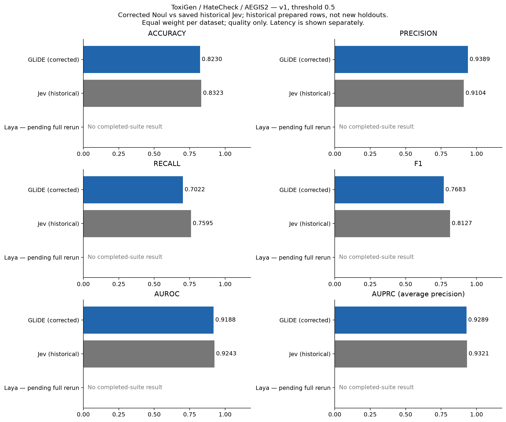

# Corrected benchmark comparison

Historical prepared rows; not the new held-out split policy. v1 / threshold 0.5 unless stated. Jev is a saved historical reference, not a rerun.

Laya: resumed after billing was restored; full rerun pending. Partial scores are excluded.

Scores use `answers.score.noul`. Historical confidence-based GLiDE/Laya scores are excluded. The previous presentation is archived in `../comparison_historical_confidence/`. The old 11-model chart is superseded: supplied summaries are retained separately below, without a combined ranking.

## Findings against historical Jev

Positive deltas favor the corrected live provider. Higher AUROC with lower fixed-threshold F1 suggests threshold calibration deserves investigation; it does not establish better classification performance or justify choosing thresholds on these test rows.

| provider | dataset | prompt | f1_delta | auroc_delta |
|---|---|---|---|---|
| fastino.ai | aegis2 | v1 | 0.0241 | 0.0149 |
| fastino.ai | aegis2 | v2 | 0.0382 | 0.0139 |
| fastino.ai | detect-jailbreak | v1 | -0.1347 | 0.0134 |
| fastino.ai | detect-jailbreak | v2 | -0.1022 | 0.0116 |
| fastino.ai | hatecheck | v1 | 0.0200 | 0.0038 |
| fastino.ai | hatecheck | v2 | 0.0315 | 0.0052 |
| fastino.ai | jailbreak-classification | v1 | -0.0012 | -0.0012 |
| fastino.ai | jailbreak-classification | v2 | 0.0065 | -0.0007 |
| fastino.ai | jailbreakhub | v1 | -0.0891 | 0.0169 |
| fastino.ai | jailbreakhub | v2 | -0.0579 | 0.0109 |
| fastino.ai | toxigen | v1 | -0.1772 | -0.0352 |
| fastino.ai | toxigen | v2 | -0.0626 | -0.0242 |

## Three-dataset macro averages

Equal dataset weights, not pooled rows. AUPRC means average precision. v1 is the original figure's configuration; v2 is separate.

| provider | prompt | accuracy | precision | recall | f1 | auroc | auprc | paired_rows |
|---|---|---|---|---|---|---|---|---|
| fastino.ai | v1 | 0.8230 | 0.9389 | 0.7022 | 0.7683 | 0.9188 | 0.9289 | 12481 |
| fastino.ai | v2 | 0.8494 | 0.9383 | 0.7544 | 0.8201 | 0.9231 | 0.9334 | 12481 |
| historical_jev | v1 | 0.8323 | 0.9104 | 0.7595 | 0.8127 | 0.9243 | 0.9321 | 12481 |
| historical_jev | v2 | 0.8355 | 0.9192 | 0.7544 | 0.8177 | 0.9248 | 0.9318 | 12481 |

## Classification by dataset

Quality excludes request errors and uses matching successful sample IDs, text and labels. The same common rows are required for all included providers. Detect Jailbreak excludes historical NUL-truncated sample 15837 from paired quality only. Historical Jev's requested model was `jev-latest`; its resolved model version is unknown.

| provider | dataset | prompt | paired_rows | excluded_nul_rows | accuracy | precision | recall | f1 | auroc | auprc | fpr | fnr |
|---|---|---|---|---|---|---|---|---|---|---|---|---|
| fastino.ai | aegis2 | v1 | 1964 | 0 | 0.8371 | 0.8927 | 0.7932 | 0.8400 | 0.9198 | 0.9356 | 0.1116 | 0.2068 |
| historical_jev | aegis2 | v1 | 1964 | 0 | 0.8096 | 0.8520 | 0.7828 | 0.8159 | 0.9049 | 0.9178 | 0.1591 | 0.2172 |
| fastino.ai | aegis2 | v2 | 1964 | 0 | 0.8315 | 0.8848 | 0.7904 | 0.8349 | 0.9193 | 0.9335 | 0.1204 | 0.2096 |
| historical_jev | aegis2 | v2 | 1964 | 0 | 0.8004 | 0.8838 | 0.7252 | 0.7967 | 0.9054 | 0.9166 | 0.1116 | 0.2748 |
| fastino.ai | detect-jailbreak | v1 | 18257 | 1 | 0.6824 | 0.2493 | 0.9700 | 0.3966 | 0.9419 | 0.7009 | 0.3523 | 0.0300 |
| historical_jev | detect-jailbreak | v1 | 18257 | 1 | 0.8331 | 0.3807 | 0.8789 | 0.5313 | 0.9285 | 0.6814 | 0.1724 | 0.1211 |
| fastino.ai | detect-jailbreak | v2 | 18257 | 1 | 0.6909 | 0.2525 | 0.9547 | 0.3993 | 0.9311 | 0.6502 | 0.3410 | 0.0453 |
| historical_jev | detect-jailbreak | v2 | 18257 | 1 | 0.8111 | 0.3502 | 0.8830 | 0.5015 | 0.9195 | 0.6243 | 0.1976 | 0.1170 |
| fastino.ai | hatecheck | v1 | 3728 | 0 | 0.9769 | 0.9762 | 0.9906 | 0.9833 | 0.9966 | 0.9984 | 0.0532 | 0.0094 |
| historical_jev | hatecheck | v1 | 3728 | 0 | 0.9482 | 0.9392 | 0.9887 | 0.9633 | 0.9928 | 0.9968 | 0.1408 | 0.0113 |
| fastino.ai | hatecheck | v2 | 3728 | 0 | 0.9933 | 0.9919 | 0.9984 | 0.9951 | 0.9995 | 0.9998 | 0.0180 | 0.0016 |
| historical_jev | hatecheck | v2 | 3728 | 0 | 0.9488 | 0.9415 | 0.9867 | 0.9636 | 0.9943 | 0.9975 | 0.1348 | 0.0133 |
| fastino.ai | jailbreak-classification | v1 | 1044 | 0 | 0.9473 | 0.9214 | 0.9791 | 0.9494 | 0.9932 | 0.9942 | 0.0851 | 0.0209 |
| historical_jev | jailbreak-classification | v1 | 1044 | 0 | 0.9521 | 0.9918 | 0.9127 | 0.9506 | 0.9943 | 0.9945 | 0.0077 | 0.0873 |
| fastino.ai | jailbreak-classification | v2 | 1044 | 0 | 0.9569 | 0.9398 | 0.9772 | 0.9581 | 0.9941 | 0.9947 | 0.0638 | 0.0228 |
| historical_jev | jailbreak-classification | v2 | 1044 | 0 | 0.9531 | 0.9918 | 0.9146 | 0.9516 | 0.9948 | 0.9949 | 0.0077 | 0.0854 |
| fastino.ai | jailbreakhub | v1 | 15140 | 0 | 0.6546 | 0.2048 | 0.9445 | 0.3367 | 0.9142 | 0.5978 | 0.3750 | 0.0555 |
| historical_jev | jailbreakhub | v1 | 15140 | 0 | 0.7819 | 0.2817 | 0.8712 | 0.4257 | 0.8973 | 0.5255 | 0.2272 | 0.1288 |
| fastino.ai | jailbreakhub | v2 | 15140 | 0 | 0.6971 | 0.2268 | 0.9395 | 0.3653 | 0.9046 | 0.4835 | 0.3277 | 0.0605 |
| historical_jev | jailbreakhub | v2 | 15140 | 0 | 0.7813 | 0.2802 | 0.8648 | 0.4233 | 0.8937 | 0.4887 | 0.2272 | 0.1352 |
| fastino.ai | toxigen | v1 | 6789 | 0 | 0.6549 | 0.9477 | 0.3228 | 0.4815 | 0.8400 | 0.8527 | 0.0176 | 0.6772 |
| historical_jev | toxigen | v1 | 6789 | 0 | 0.7391 | 0.9400 | 0.5070 | 0.6587 | 0.8752 | 0.8817 | 0.0319 | 0.4930 |
| fastino.ai | toxigen | v2 | 6789 | 0 | 0.7235 | 0.9384 | 0.4743 | 0.6301 | 0.8504 | 0.8670 | 0.0307 | 0.5257 |
| historical_jev | toxigen | v2 | 6789 | 0 | 0.7573 | 0.9323 | 0.5512 | 0.6928 | 0.8746 | 0.8814 | 0.0395 | 0.4488 |

## Coverage and request timing

Missing/error rows are not counted as negatives. Latency includes retries under the listed concurrency. Historical serial timings and supplied aggregate timings are not comparable to these measurements and are omitted from quality charts.

| provider | dataset | prompt | valid | errors | expected | workers | mean_ms | p50_ms | p95_ms |
|---|---|---|---|---|---|---|---|---|---|
| fastino.ai | aegis2 | v1 | 1964 | 0 | 1964 | 32 | 498.5629 | 447.8188 | 837.0714 |
| fastino.ai | aegis2 | v2 | 1964 | 0 | 1964 | 32 | 491.8338 | 444.5702 | 799.5886 |
| fastino.ai | detect-jailbreak | v1 | 18258 | 0 | 18258 | 32 | 504.6368 | 471.1110 | 765.7865 |
| fastino.ai | detect-jailbreak | v2 | 18258 | 0 | 18258 | 32 | 549.4541 | 470.4219 | 829.2212 |
| fastino.ai | hatecheck | v1 | 3728 | 0 | 3728 | 32 | 558.4088 | 490.7888 | 1088.8150 |
| fastino.ai | hatecheck | v2 | 3728 | 0 | 3728 | 32 | 503.0429 | 448.5488 | 823.6389 |
| fastino.ai | jailbreak-classification | v1 | 1044 | 0 | 1044 | 32 | 605.2778 | 531.5999 | 1221.1739 |
| fastino.ai | jailbreak-classification | v2 | 1044 | 0 | 1044 | 32 | 568.5412 | 498.1759 | 1095.6176 |
| fastino.ai | jailbreakhub | v1 | 15140 | 0 | 15140 | 32 | 509.4604 | 461.9128 | 858.4194 |
| fastino.ai | jailbreakhub | v2 | 15140 | 0 | 15140 | 32 | 553.1703 | 469.8756 | 1041.7241 |
| fastino.ai | pii_masking_mini_10k | v1 | 9000 | 0 | 9000 | 32 | 451.9370 | 425.3704 | 696.9498 |
| fastino.ai | pii_masking_mini_10k | v2 | 9000 | 0 | 9000 | 32 | 500.1238 | 470.9615 | 756.0167 |
| fastino.ai | pii_masking_nano_1k | v1 | 900 | 0 | 900 | 32 | 563.3786 | 512.0003 | 1082.9768 |
| fastino.ai | pii_masking_nano_1k | v2 | 900 | 0 | 900 | 32 | 505.5566 | 455.7670 | 899.4038 |
| fastino.ai | toxigen | v1 | 6789 | 0 | 6789 | 32 | 488.3889 | 447.1087 | 785.4195 |
| fastino.ai | toxigen | v2 | 6789 | 0 | 6789 | 32 | 537.7799 | 477.3067 | 1040.6861 |

## PII detection diagnostics

All-positive document labels: detection rate alone cannot measure extraction, false positives, leakage or over-masking. Use the separate PII span-extraction workflow for extraction quality.

| provider | dataset | prompt | valid | expected | detection_rate |
|---|---|---|---|---|---|
| fastino.ai | pii_masking_mini_10k | v1 | 9000 | 9000 | 0.9262 |
| fastino.ai | pii_masking_mini_10k | v2 | 9000 | 9000 | 0.9530 |
| fastino.ai | pii_masking_nano_1k | v1 | 900 | 900 | 0.9233 |
| fastino.ai | pii_masking_nano_1k | v2 | 900 | 900 | 0.9456 |

## Supplied aggregate references — unpaired

Preserved source values, not a fresh evaluation. Dataset membership, labels, successful rows, prompt configuration and timing are not uniformly verified. No combined ranking or latency speedup is claimed. F1 remains missing where not supplied.

| provider | prompt | accuracy | precision | recall | f1 | auroc | mean_elapsed_ms |
|---|---|---|---|---|---|---|---|
| openjev | v1 | 0.7773 | 0.8482666666666666 | 0.7211 | 0.7631666666666667 | 0.8562333333333333 | 868.2366666666667 |
| openjev-32b | v1 | 0.7799446666666666 | 0.9063463333333334 | 0.6577933333333333 | 0.737671 | 0.867307 | 1818.546583 |
| microsoft-decision-1 | v1 | 0.8318953333333333 | 0.936145 | 0.72204 | 0.7990336666666666 | 0.918753 | 1239.601246 |
| Dynamo CPU | not_supplied | 0.8965 | 0.8888 | 0.9086 |  | 0.9527 | 20000.0 |
| Dynamo GPU (A100) | not_supplied | 0.8941 | 0.8869 | 0.9106 |  | 0.9524 | 55.0 |
| Dynamo GPU (L4) | not_supplied | 0.8939 | 0.8869 | 0.9102 |  | 0.9524 | 100.0 |
| Mistral | not_supplied | 0.8333 | 0.8564 | 0.834 |  |  | 1671.08 |
| Warden | not_supplied | 0.7773 | 0.8203 | 0.7611 |  |  | 328.53 |

## Reproduction and limitations

Run `python -m scripts.publish_corrected_comparison` after completing or resuming a provider suite. The publisher checks source hashes, revalidates paired text/labels and computes AUPRC from saved probabilities; it makes no API calls. Provider status declares the full expected dataset/prompt matrix, preventing partial-suite publication. Thresholds 0.5–0.8 use one probability per row/prompt, not independent repeat inferences. These are historical-row parity benchmarks; split-policy PR #19 requires a separate rerun. The Notion fine-tuning evaluation populations also differ.

[Figure gallery](figures/index.html) · [All figures PDF](figures/paper_figures.pdf) · [Machine-readable report](comparison.json) · [Three-dataset CSV](figures/three_dataset_averages.csv)
